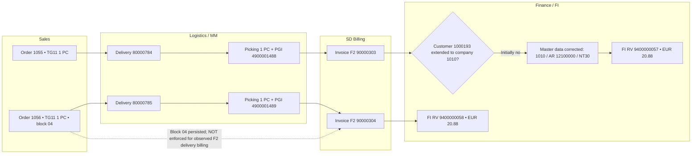

# M2 — Executed O2C Swimlane and Exception Decision Points

**System:** SAP S/4HANA Cloud Public Edition training sandbox JV2 / 100.  
**Dates:** 16–17 November 2026. **No production client activity.**  
**Scope:** Executed **Sales → Logistics → Finance** document links for orders 1055 and 1056, with two observed exceptions.

## Process swimlane — actual document identifiers

**Important:** The chart illustrates verified document chains, not actual physical delivery dates or an independently proven billing-block configuration mechanism. The failure at 90000303 was resolved via customer company-code setup. The billing-block behavior on order 1056 remains open.

## Exception decision points and control ownership

| Stage | Decision / control | Scenario 1 actual | Scenario 2 actual | Primary functional owner |
|---|---|---|---|---|
| Sales order | Sold-to/ship-to, material, sales area, pricing and ATP valid? | Standard item; prior M1 block removed | Confirmed 1 PC, schedule line CP | Sales / SD |
| Delivery creation | Eligible schedule/quantity and no delivery block? | 80000784 created | 80000785 created | Logistics / SD |
| Picking / PGI | Picked qty = delivery qty, material document created? | 1 PC; PGI 4900001488 | 1 PC; PGI 4900001489 | Warehouse / MM |
| Billing | Invoice correct and billing control enforced? | F2 90000303; no billing-block test | F2 90000304 **created despite block 04** | Billing / SD |
| FI interface | Customer accounting master present and journal created? | First failed for missing company code; corrected | RV 9400000058 created | FI / Customer master |
| FI reconciliation | Receivable = revenue + output tax? | 20.88 = 17.55 + 3.33 | 20.88 = 17.55 + 3.33 | FI |
| Receivables | Payment recorded and invoice cleared? | Not performed | Not performed | FI / AR |

## Related evidence

[Scenario 1 trace](O2C-Scenario-01-Standard-and-FI-Correction.md) · [Scenario 2 trace](O2C-Scenario-02-Billing-Block-Exception.md) · [Evidence register](../00-Project-Tracking/Evidence-Register.md).
