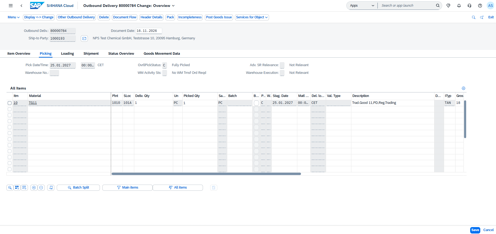
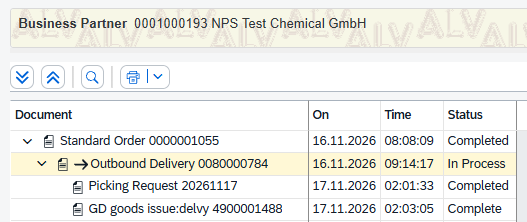
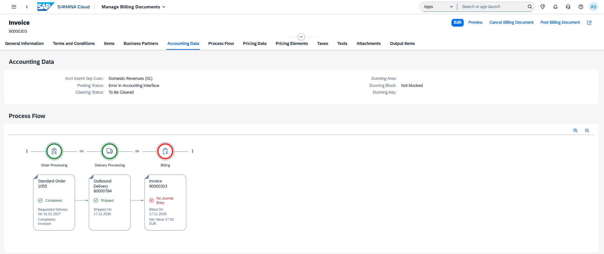
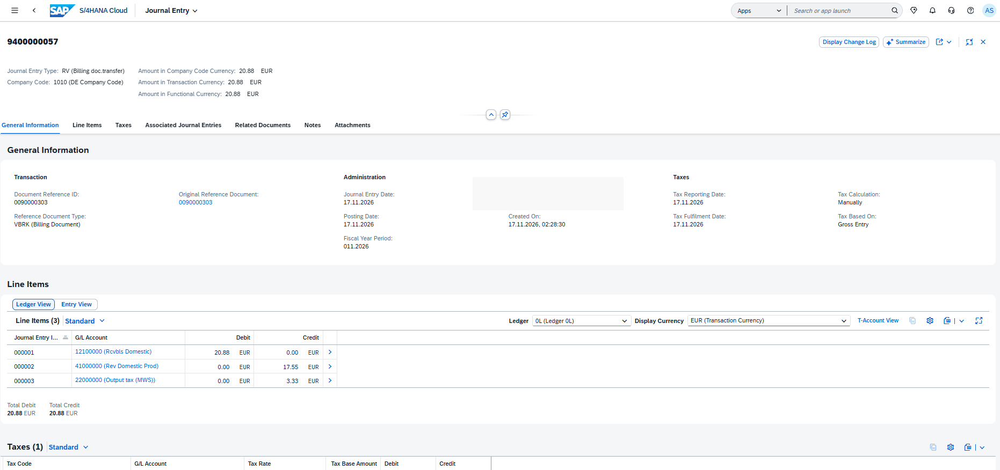

# M9-TRN-001 — SAP SD key-user training demonstration and FAQ

**Classification:** **Prepared screenshot-based demonstration; not delivered to real users.** No new SAP transaction, test participant, attendance, training recording, learning assessment or approval.

**Requirement:** R13; M9.03.  
**System shown:** JV2 / client 100, SAP S/4HANA Cloud Public Edition; historical Fiori and WebGUI screenshots.  
**Primary source:** [O2C-SD-001](../M2-Order-to-Cash/O2C-Scenario-01-Standard-and-FI-Correction.md), supported by [M2 executed control flow](../M2-Order-to-Cash/O2C-Executed-Swimlane-and-Controls.md), [INC-SD-001 pricing](../M5-Incident-and-Root-Cause-Management/Incident-INC-SD-001-Pricing.md), [INC-SD-002 picking](../M5-Incident-and-Root-Cause-Management/Incident-INC-SD-002-Picking.md), and [INC-SD-003 FI posting](../M5-Incident-and-Root-Cause-Management/Incident-INC-SD-003-Billing-FI.md).

## 1. Audience, outcome and method

| Audience | Learning outcome | Relevant display/inspection |
|---|---|---|
| Sales order / key user | Identify order, customer, price, document flow and delivery status | VA03 / applicable Fiori sales-order display |
| Logistics / warehouse key user | Distinguish delivery quantity, picked quantity, PGI and material document | VL02N/VL03N or applicable delivery display; document flow |
| Billing / finance key user | Distinguish invoice creation from FI posting; identify a missing-master error | VF03 / Manage Billing Documents / journal display |
| L1 / cross-functional key user | Preserve evidence, choose the right escalation and prevent duplicate or unauthorized processing | Screenshots, document references and escalation checklist |

**Delivery approach:** Facilitator walks through previously captured evidence **read-only**. Trainees would follow a checklist and explain decisions. **There is no claim that any trainee did so.** Screen availability and menu names may differ by tenant and assigned role; no new or live production documents should be created for this demo.

## 2. Demonstration — trace one verified order to accounting

**Actual training record:** Sales organization **1010 / 10 / 00**; company code **1010**; customer **1000193**; material **TG11**; quantity **1 PC**; price **PPR0 EUR 17.55**. The customer and organization were in the original German training scenario; this is not an actual Japanese customer operation.

| Stage | Facilitator shows | Confirmed historical result | Evidence / safe user observation |
|---|---|---|---|
| 1. Order | OR sales order **1055**, customer, item, net price, document flow | 1 PC TG11 at EUR 17.55; previous controlled delivery block had been removed | [M2 order trace](../M2-Order-to-Cash/O2C-Scenario-01-Standard-and-FI-Correction.md); EV-014 pricing baseline |
| 2. Delivery and picking | Delivery **80000784**, item quantity and picking status | 1 PC picked; **C — Fully Picked** | [EV-017 picking screenshot](../M2-Order-to-Cash/evidence/m2-sc1-picking-fully-picked.png) |
| 3. Goods issue | Delivery document flow and material-document viewer | PGI material document **4900001488** created | [EV-018 PGI flow](../M2-Order-to-Cash/evidence/m2-sc1-pgi-document-flow.png), [EV-019 material document](../M2-Order-to-Cash/evidence/m2-sc1-material-document.png) |
| 4. Invoice | F2 billing document **90000303** | Invoice created, EUR 17.55 net + EUR 3.33 tax = EUR 20.88 | [EV-020 billing](../M2-Order-to-Cash/evidence/m2-sc1-billing-f2-preview.png) |
| 5. FI exception | Billing posting status, exact message and customer company-code view | FI initially failed because customer 1000193 was not defined in company code 1010 | [EV-021 error](../M2-Order-to-Cash/evidence/m2-sc1-fi-interface-error.png), [EV-022 detail](../M2-Order-to-Cash/evidence/m2-sc1-fi-master-error.png), [EV-023 master](../M2-Order-to-Cash/evidence/m2-sc1-customer-company-code-missing.png) |
| 6. Corrected outcome | Billing → FI document flow and posted journal | FI journal **9400000057**; EUR 20.88 debit = EUR 20.88 credit | [EV-025 posting](../M2-Order-to-Cash/evidence/m2-sc1-billing-fi-success.png), [EV-026 FI journal](../M2-Order-to-Cash/evidence/m2-sc1-fi-ledger-redacted.png) |

**Demonstration conclusion:** The original O2C training process reached invoice and balanced FI posting, **after** a genuine customer master-data correction. Payment / receivable clearing was **not** executed; journal `Not Cleared` does not mean an accounting transfer failure. Storage stock movement totals and movement type were not independently verified.

### Example screenshots to show in sequence

**Picking status:**

**Goods-issue document flow:**

**Invoice accounting error — not invoice-creation failure:**

**Accounted invoice — verified FI journal:**

## 3. Three focused exception discussions

### Pricing: controlled manual PPR0 override (INC-SD-001)

- Historical scenario: order **1056**, item 10, valid PPR0 **EUR 17.55** manually replaced with **EUR 15.55**; Pricing Analysis message **203** identified manual change (EV-014–EV-015).
- Historical remedy: original price restored to **EUR 17.55** and rechecked in VA03 (EV-016, EV-072). This is a **resolved controlled sandbox incident**, not proof that manual overrides are technically disabled.
- Key-user habit: compare price/condition source before approval; escalate unexplained price differences rather than independently overwriting approved pricing.

### Picking: quantities differ (INC-SD-002)

- Historical scenario: order **1059**, delivery **80000788**, **2 PC** delivery but **1 PC** picked. SAP prevented PGI with **VLMOVE 030** (EV-045–EV-047).
- Historical remedy: after correcting the picked quantity in the controlled exercise, goods issue material document **4900001491** was created (EV-048, EV-073). Actual physical stock reconciliation was not separately verified.
- Key-user habit: confirm physical goods and authorization before altering pick quantities. **Do not** merely change SAP quantity to bypass a warehouse discrepancy.

### Billing and FI: invoice exists, journal does not (INC-SD-003)

- Historical scenario: invoice **90000303** saved but FI transfer failed due to missing customer company-code data (EV-021–EV-023).
- Historical remedy: customer/1010 master data maintained with subsequent balanced FI posting (EV-024–EV-026).
- Key-user habit: escalate to master-data/FI owner with **the original invoice number**. **Do not create a second invoice** or change financial master data without authorization.

## 4. FAQ — safe user actions and escalation

| User question | Safe answer / next action | Not established / avoid |
|---|---|---|
| “Where is my order?” | Display the known sales order and its document flow; note the last completed document | Do not assume a successful order means it is delivered or billed |
| “Why can’t we post goods issue?” | Compare delivery and picked quantity; capture the exact error. VLMOVE 030 was a valid safeguard in the tested case | Do not falsify picking or assume a stock shortage without checking |
| “Price differs from the master condition” | Review pricing condition analysis and approved pricing source; route manual override for business review | Do not assume all manual pricing changes are forbidden or a system defect |
| “Invoice was created; why no FI entry?” | Check posting status and error; send the original invoice and exact message to FI/master-data support | Do not duplicate billing; FI posting is a distinct step |
| “Does billing block 04 stop F2?” | **Do not rely on that as a proven control in JV2.** Refer to the open [PRB-SD-001](../M5-Incident-and-Root-Cause-Management/Problem-Record-PRB-SD-001.md) | Four tested block levels did **not** provide the proposed hold; root cause/valid rule unresolved |
| “Can I change authorization/configuration?” | Raise an access/change request with owner, business need and least-privilege scope | CBC access remains **Unauthorized**; no role/config approval |
| “Invoice is Not Cleared — did posting fail?” | Not necessarily: FI journal 9400000057 exists; clearing/payment is a separate AR activity | Do not interpret open receivable as failed billing transfer |
| “How should I contact support?” | Give system/client, app/transaction, document IDs, expected/actual, exact message and sanitized screenshot | Do not publish credentials, personal data or confidential customer data |

## 5. Suggested read-only trainee questions (not administered)

1. Which document establishes that goods issue occurred for delivery 80000784?
2. In the recorded FI exception, did invoice creation fail or did the subsequent accounting transfer fail?
3. Which SAP error field identified the company-code master-data omission?
4. Who should approve a customer company-code data correction in a real project?
5. What is the correct safe action when a delivery is partly picked and PGI is rejected?
6. Why is billing block 04 **not** presented as an effective preventive control in this portfolio?

**Answer key:** (1) Material document **4900001488** / EV-018–EV-019. (2) FI transfer failed **after** invoice creation. (3) Customer **1000193**, company code **1010** / EV-022. (4) Authorized FI/master-data owner under business governance. (5) Reconcile real goods and pick quantity, not invent quantities. (6) Historical JV2 negative tests did not stop F2 and the JV2 customizing cause remains unknown.

## 6. Training package acceptance and limitations

| Criterion | Status |
|---|---|
| Reused order-to-billing evidence is traceable | **Documented** (existing EV IDs and links) |
| Presentation script, FAQ, troubleshooting and safe actions prepared | **Completed as documentation** |
| Real trainer delivery or video recording | **Not performed** |
| Trainee participation and demonstrated proficiency | **Not evaluated** |
| Business process owner review and training approval | **Not obtained** |
| New SAP transactions or screenshots for M9 | **None** |

**Outcome:** A reusable, evidence-based key-user training **guide**, not proof of real end-user training or independently completed trainee exercises.
